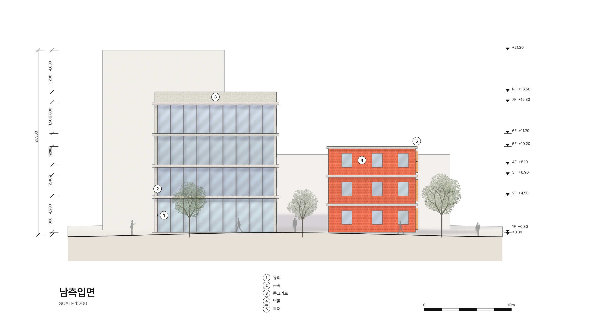

# 입면도 자동 생성 (Project_Elevation_Generator)

라이노(Rhino) 3dm 모델을 넣으면 **동·서·남·북 입면도**를 자동으로 만들어 주는 프로그램입니다.
건축 설계 과제나 실무에서 매스·외장 모델을 만든 뒤, 입면도를 Make2D로 뽑고 손으로 다듬는 시간을 줄이려고 만들었습니다.



> 위 그림은 저장소에 들어 있는 **가상의 시험 모델**로 만든 결과입니다(실제 프로젝트 도면이 아님).

## 무엇을 해 주나요

- **입면 4방향 자동 생성**: 모델을 정사영으로 그려 외곽선·모서리·그림자·재료 표현을 넣습니다. 진북 각도를 넣으면 방위에 맞춰 돌립니다.
- **층 레벨 자동 표시**: 슬래브 높이를 찾아 `1F FL +300` 같은 레벨과 높이 치수를 붙입니다. GL 해발을 넣으면 `+4.69 = EL 37.69`처럼 함께 적습니다.
- **지형 단면**: 지형 레이어를 단면으로 잘라 땅을 그립니다.
- **재료 번호(범례)**: 레이어 이름·재질 이름으로 유리, 금속, 콘크리트, 벽돌, 목재, 수목 등을 알아서 나누고 번호를 붙입니다. 화면에서 고칠 수 있습니다.
- **두 가지 표현**
  - 일반: 선과 해치 중심의 도면 표현
  - 콜라주: 재료별 텍스처, 부드러운 그림자, 뒤쪽일수록 흐려지는 깊이감, 나무·사람 점경
- **내보내기**: PNG, PDF, SVG(일러스트 레이어 정리 스크립트 포함), DXF, 3dm, 여러 입면을 모은 A3~A0 도면 시트 PDF
- **주변 건물**: `주변`, `인접`, `context` 같은 이름의 레이어는 그리되 층 계산에서는 뺍니다.

## 어떻게 쓰나요

### 1. 모델 준비(라이노에서)

- 레이어 이름에 재료가 드러나게 해 주세요. 예: `외벽_콘크리트`, `창_유리`, `프레임`, `벽돌`, `나무`, `지형`, `주변 건물`
- **일반 저장**으로 저장해 주세요. '작게 저장(Save Small)'을 하면 렌더 메시가 빠져서 일부 객체를 읽지 못합니다.
- SubD는 아직 못 읽습니다. `ToNURBS`나 `Mesh`로 바꿔 주세요.
- 라이노 8 이하에서 저장한 파일을 읽습니다.

### 2. 실행

> 설치 없이 브라우저 링크만 여는 웹판을 준비하고 있습니다. 나오면 이 자리에 링크를 적겠습니다.

**윈도우(설치 없이)**: [Releases](../../releases)에서 윈도우 묶음 zip을 받아 풀고 `입면도 실행.bat`을 더블클릭하면 브라우저에 화면이 열립니다.

화면은 네 단계입니다.

1. **모델 넣기**: 3dm 파일을 끌어다 놓거나 경로를 붙여 넣습니다.
2. **레이어·층 확인**: 레이어마다 넣기/빼기, 재료, 지형, 주변 건물을 확인합니다. 찾은 층 레벨을 고칠 수 있습니다.
3. **입면 설정**: 방향, 축척(1:50~1:500), 진북, 표현(일반/콜라주), 종이 크기, 내보낼 형식을 고르고 미리보기를 봅니다.
4. **결과**: 파일을 내려받거나 결과 폴더를 엽니다.

결과와 설정은 `사용자 폴더\입면도\` 아래에 모델 이름과 시각으로 저장됩니다. 같은 모델을 다시 넣으면 지난 레이어 설정을 불러옵니다.

### 내 자료 넣기(저장소에는 올리지 않음)

| 자료 | 넣는 곳 |
| --- | --- |
| 내 3dm 모델 | 화면 1단계에서 직접 지정 |
| 재료 텍스처 그림 | 화면 3단계 '텍스처 그림 올리기' (`사용자 폴더\입면도\_재료`) |
| 나무 점경 PNG(배경 투명) | `사용자 폴더\입면도\_점경` |

개인 도면, 수업·실무 모델, 재배포가 금지된 자료(예: 정밀도로지도)는 이 저장소에 올리지 않습니다. 프로그램은 항상 사용자가 지정한 파일을 읽습니다.

## 개발과 자동 시험

### 폴더 구조

```
elevation_ai/          프로그램 본체
  app.py               브라우저 화면용 작은 서버 (python -m elevation_ai → http://127.0.0.1:8766)
  jobs.py              입면 만들기 전체 흐름, 설정 저장
  model3dm.py          3dm 읽기(렌더 메시·블록)
  elevation.py         정사영·선 추출·재료 분류
  draw.py              PNG/PDF/SVG/DXF/3dm 그리기와 도면 시트
  collage.py           콜라주 표현, entourage.py 나무·사람 점경
  raster.py, imgops.py 깊이 버퍼·흐림(네이티브 C 라이브러리, 없으면 numpy로 대신)
  web/index.html       화면
  fonts/, textures/    Pretendard 글꼴(OFL), 기본 텍스처·나무 그림
native/raster.c        래스터라이저 C 소스 (dll/so는 Actions가 빌드)
tests/
  make_sample_model.py 가상의 시험 대지 3dm을 코드로 만듦(건물 2동, 주변 건물, 지형, 나무)
  test_sample.py       예제 입력 시험
  reference/           기준 그림
```

### 자동 시험(GitHub Actions)

커밋과 PR마다 [시험](../../actions/workflows/test.yml)이 **Windows와 Linux**에서 돌아갑니다.

1. `native/raster.c`로 윈도우 dll과 리눅스 so를 빌드합니다.
2. 파이썬 3.12와 `requirements.txt`를 설치합니다.
3. 시험 모델을 만들고 다음을 확인합니다.
   - 네이티브 라이브러리가 실제로 읽히는지
   - 레이어·재료·지형·주변 건물이 바르게 분류되는지
   - 남·동측 입면을 일반·콜라주 두 표현으로 만들어 PNG/PDF/SVG/DXF/시트가 모두 나오는지
   - 그림이 비어 있지 않고, 기준 그림(`tests/reference`)과 2% 넘게 달라지지 않았는지
   - 명령줄 실행과 화면 서버 흐름(모델 올리기 → 레이어 확인 → 만들기 → 결과 받기)이 끝까지 도는지
4. 결과 그림은 Actions 실행 화면의 **Artifacts**(`result-images-…`)에 남습니다. 기준과 다르면 차이를 빨갛게 표시한 `diff_*.png`도 함께 남습니다.

그림을 일부러 바꾸는 개선이면 같은 PR에서 `tests/reference`의 기준 그림도 바꿉니다.

### 작업 방식

- 개선은 브랜치에서 하고 PR로 올립니다. PR에는 바뀐 점, 시험 결과, 확인 그림을 담습니다.
- 시험을 통과하지 않은 PR은 합치지 않습니다.
- API 키 같은 비밀 값은 저장소에 넣지 않고 GitHub Secrets나 사용자 입력으로 받습니다.

### 직접 돌려 보기(개발자용)

```bash
pip install -r requirements.txt pytest
gcc -O3 -shared -fPIC -o elevation_ai/raster_linux64.so native/raster.c -lm   # 없으면 느린 numpy로 돌아감
python tests/make_sample_model.py sample.3dm
python -m elevation_ai sample.3dm --scale 200 --views 남측입면,동측입면   # 명령줄
python -m elevation_ai                                                    # 화면
python -m pytest tests
```

## 라이선스

글꼴은 [Pretendard](elevation_ai/fonts/PRETENDARD_LICENSE.txt)(SIL Open Font License)입니다.
